# UIII Act6 Preparación y evaluación de imágenes para Visión Artificial
#### Iram Jimenez NC = 0079
## Preparación y Evaluación de Imágenes para Visión Artificial

> **Nivel:** Básico – Principiante (Desde cero)  
> **Duración:** 2 horas  
> **Asignatura:** Soluciona problemas de Visión Artificial  
> **Especialidad:** Inteligencia Artificial  
> **Semestre:** 3º de Preparatoria  
> **Herramientas:** Python, Visual Studio Code, OpenCV y NumPy.

## Ciclistas (imagen original)
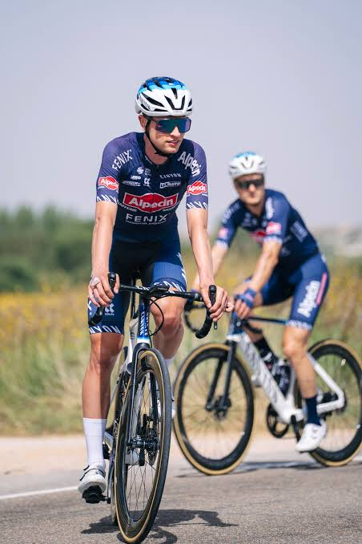
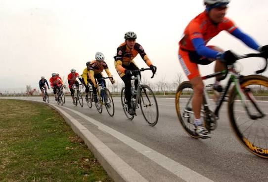

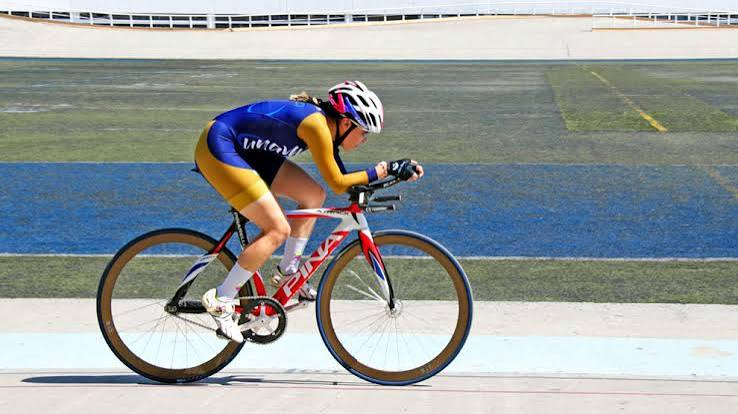
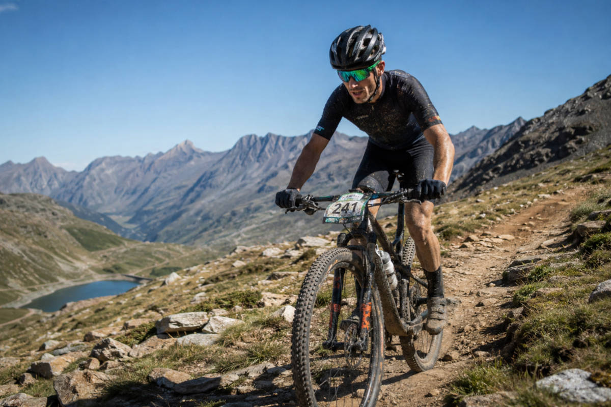

## Nadadores (imagen original)
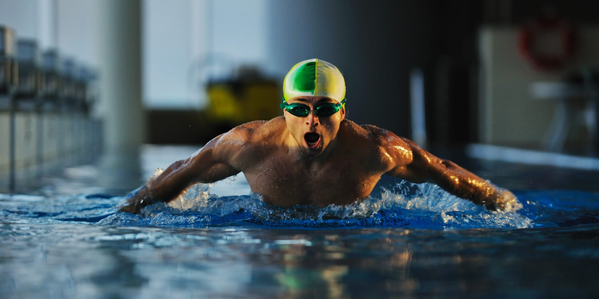
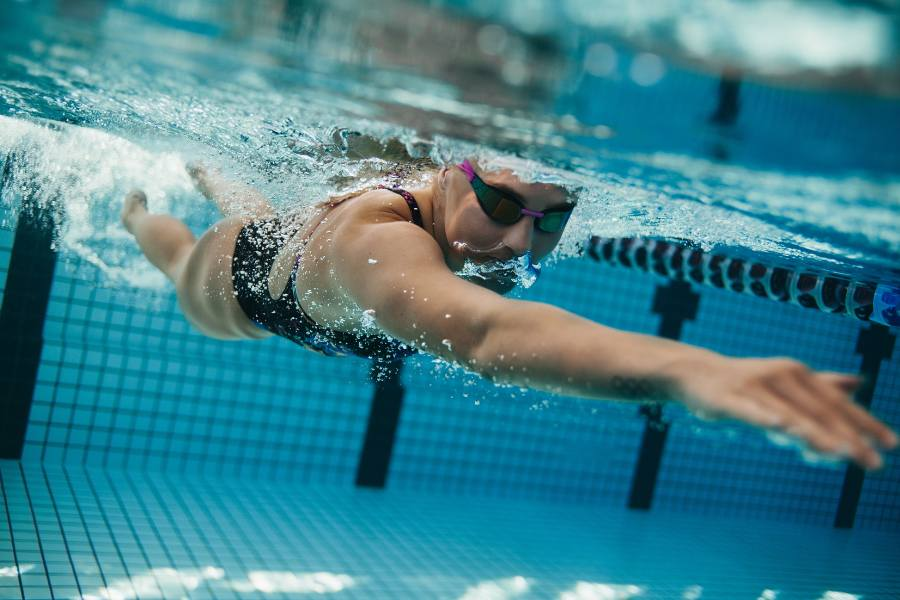

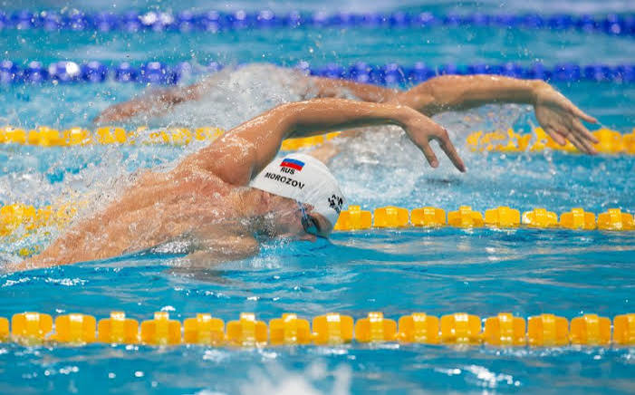

## Analisis de pixeles 
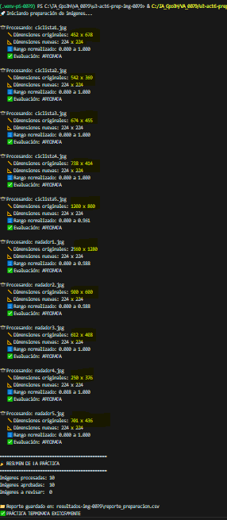

## Ciclistas (imagenes preparadas)

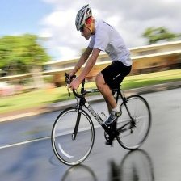

## Nadadores (imagenes preparadas)

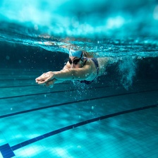
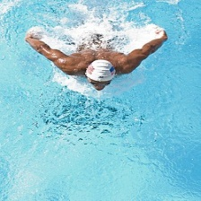
